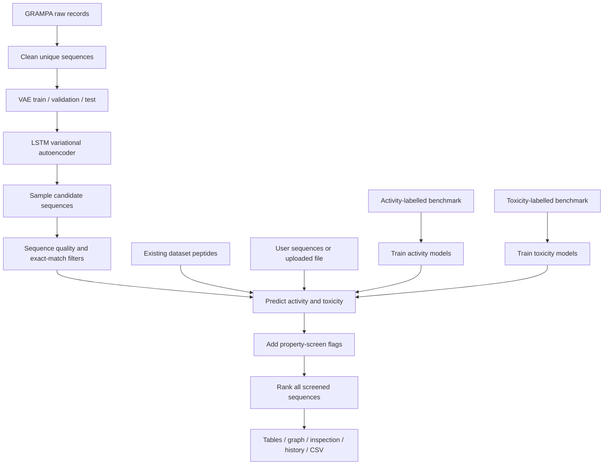
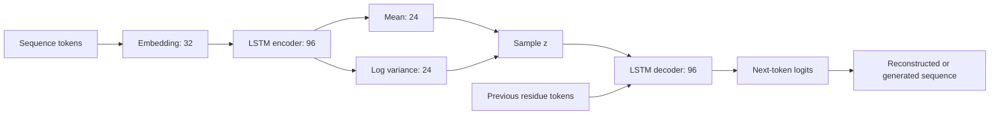
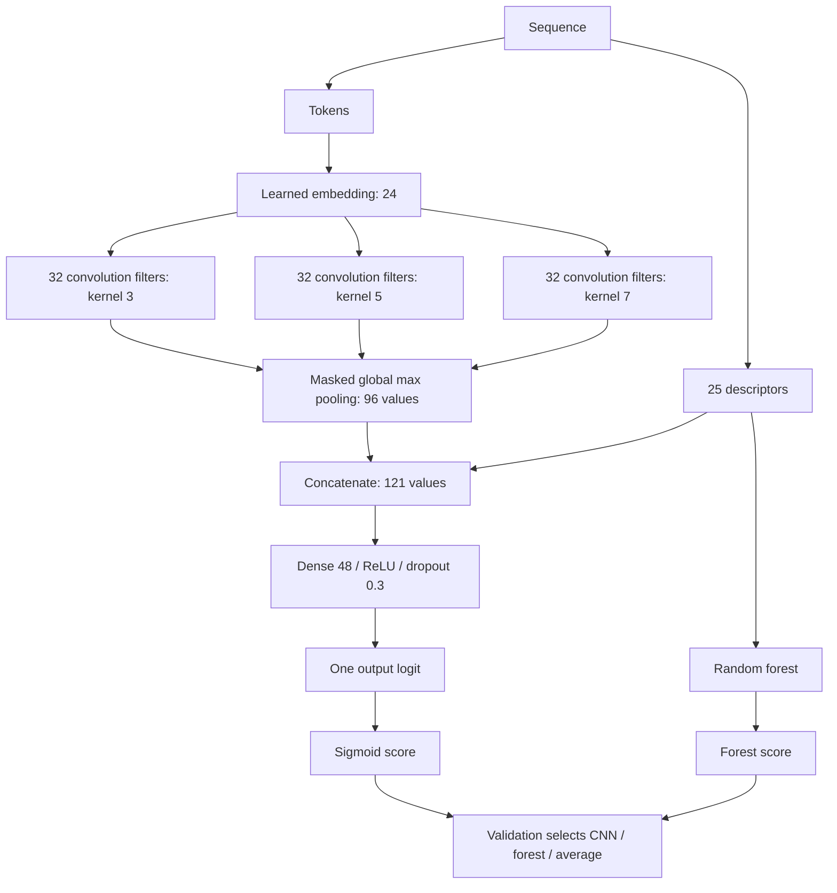
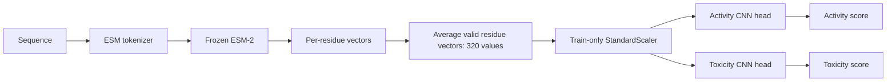
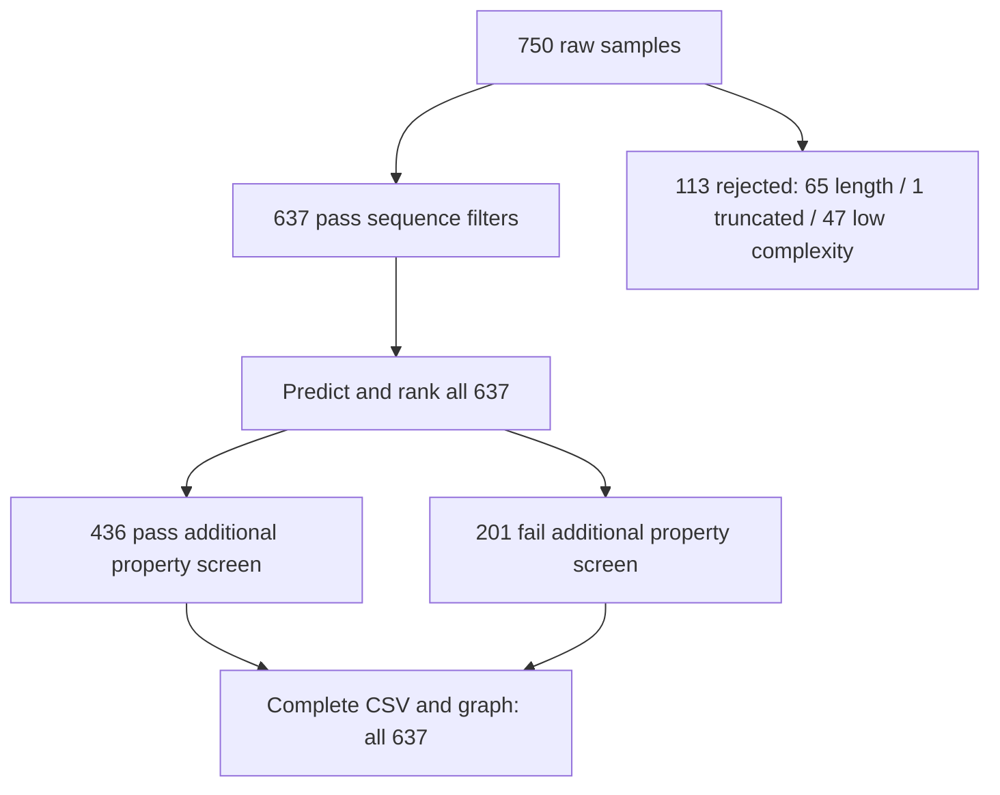
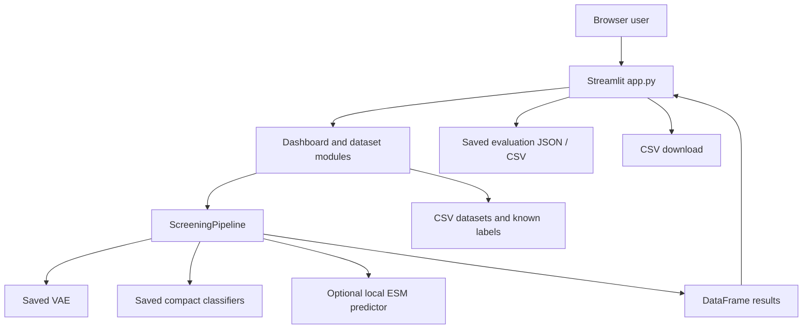

# PeptideLab: The Complete Master Guide

**A beginner-friendly explanation of the biology, data, models, mathematics, dashboard, results, code, and demonstration.**

Prepared for the project team. Updated 24 November 2026.

> Read Sections 1–6 first to understand the idea. Read Sections 7–15 to understand the models and calculations. Use Sections 16–24 while running the project and preparing for your evaluation.

---

## Contents

1. [The project in one minute](#1-the-project-in-one-minute)
2. [Basic biological definitions](#2-basic-biological-definitions)
3. [What the project actually predicts](#3-what-the-project-actually-predicts)
4. [Complete workflow](#4-complete-workflow)
5. [Datasets and their connections](#5-datasets-and-their-connections)
6. [Preprocessing and dataset splitting](#6-preprocessing-and-dataset-splitting)
7. [How sequences become numbers](#7-how-sequences-become-numbers)
8. [The VAE generator](#8-the-vae-generator)
9. [VAE losses and training](#9-vae-losses-and-training)
10. [The compact prediction engine](#10-the-compact-prediction-engine)
11. [The ESM-2 prediction engine](#11-the-esm-2-prediction-engine)
12. [Classifier training and predictions](#12-classifier-training-and-predictions)
13. [Sequence filters and property screening](#13-sequence-filters-and-property-screening)
14. [Ranking rules with worked examples](#14-ranking-rules-with-worked-examples)
15. [Evaluation metrics and actual results](#15-evaluation-metrics-and-actual-results)
16. [Dashboard walkthrough](#16-dashboard-walkthrough)
17. [Research checks and limitations](#17-research-checks-and-limitations)
18. [Tools, files, and software architecture](#18-tools-files-and-software-architecture)
19. [Installation and everyday use](#19-installation-and-everyday-use)
20. [Reproduction and testing](#20-reproduction-and-testing)
21. [How the supplied documents relate to this project](#21-how-the-supplied-documents-relate-to-this-project)
22. [Demonstration and team explanation](#22-demonstration-and-team-explanation)
23. [Viva questions and common misunderstandings](#23-viva-questions-and-common-misunderstandings)
24. [Glossary and further reading](#24-glossary-and-further-reading)

---

## 1. The project in one minute

**PeptideLab generates peptide sequences, predicts their antimicrobial activity and toxicity, and ranks them for further investigation.**

Imagine you have thousands of possible peptide sequences. Testing every one in a laboratory takes resources. Our software helps prioritize a smaller set using learned sequence patterns and supervised prediction models.

There are three ways to use it:

- **Generate:** ask the VAE to create candidate sequences.
- **Browse:** choose existing sequences from the supplied datasets.
- **Enter:** paste or upload your own sequences.

Every route can produce activity scores, toxicity scores, ranks, and a CSV download.

For a classroom demo, open **Target-specific screening**, select *E. coli*, and screen the default dataset peptides. Read one row across. General activity asks whether the sequence resembles an antimicrobial peptide. The organism score asks whether the measured MIC for *E. coli* falls at or below 10 µM. The toxicity score comes from a separate labeled dataset. Compare the organism prediction with the measured label in the same row. Switch to **Overall results** to see accuracy, ROC-AUC and coverage for every organism, alongside the general benchmarks.

The output is a **computational shortlist**. The project has measured software and benchmark performance; laboratory activity and safety still need experimental investigation.

### A useful analogy

Think of the application as a team of specialists:

| Specialist | Project component | Job |
|---|---|---|
| Writer | VAE | Proposes sequences using patterns it learned |
| First reviewer | Activity model | Scores resemblance to antimicrobial examples |
| Second reviewer | Toxicity model | Scores resemblance to toxic examples |
| Organizer | Screening and ranking | Checks sequences and orders the candidates |
| Control panel | Streamlit dashboard | Lets people operate and inspect the process |

The writer and the reviewers are trained separately. The VAE is not directly optimized to maximize activity or minimize toxicity.

## 2. Basic biological definitions

| Term | Simple meaning | Example or clarification |
|---|---|---|
| Amino acid | One building block of a peptide | K represents lysine; L represents leucine |
| Residue | An amino acid within a chain | A 15-residue peptide has 15 amino-acid letters |
| Sequence | The ordered amino-acid chain | `KWKLFKKIGAVLKVL` |
| Peptide | A relatively short amino-acid chain | The project works with sequence strings |
| AMP | Antimicrobial peptide | A peptide associated with antimicrobial activity |
| Antimicrobial activity | Ability to inhibit or kill microorganisms | The project uses binary benchmark labels |
| Toxicity | Harmful effects in a biological context | Here, the meaning is defined by the supplied dataset labels |
| MIC | Minimum inhibitory concentration | Experimental concentration needed to inhibit growth under stated conditions |
| Hemolysis | Damage to red blood cells | Not interchangeable with every toxicity label |
| Hydrophobicity | Tendency to prefer non-water environments | A sequence descriptor related to residue composition |

Supported amino-acid alphabet:

```text
ACDEFGHIKLMNPQRSTVWY
```

Example: `KKRDD` contains two K residues, one R residue, and two D residues. Its length is five.

The application does not model experimental dose, bacterial species, three-dimensional structure, or every chemical modification. Those missing contexts limit what the predictions mean.

## 3. What the project actually predicts

### Generation

Input: a random latent vector and sampling settings.

Output: a new sampled amino-acid sequence.

### Activity classification

Input: a peptide sequence.

Output: a score between 0 and 1 supporting the antimicrobial class.

```text
Label 1 = antimicrobial
Label 0 = non-antimicrobial
```

### Toxicity classification

Input: a peptide sequence.

Output: a score between 0 and 1 supporting the toxic class.

```text
Label 1 = toxic
Label 0 = non-toxic
```

**Positive does not always mean desirable.** Activity-positive means antimicrobial; toxicity-positive means toxic.

### Ranking

Input: the two scores and a ranking preference.

Output: a priority value and a position within the current batch.

An activity score of 0.90 is model support, not a verified 90% chance of experimental success. Scores have not been established as calibrated biological probabilities.

## 4. Complete workflow



If your Markdown viewer does not render Mermaid, read the diagram as:

```text
GRAMPA -> VAE -> generated sequences -> sequence filters --+
Dataset peptides -----------------------------------------+-> activity + toxicity
User input -----------------------------------------------+        |
                                                                  v
                                                    property flags -> ranks -> export
```

There are also two separate software workflows:

```text
TRAINING: data -> learn model parameters -> save weights -> evaluate
USING:    load saved weights -> enter sequences -> predict -> export
```

Clicking Predict in the dashboard uses saved weights. It does not retrain models.

## 5. Datasets and their connections

| Dataset | Purpose | Important distinction |
|---|---|---|
| GRAMPA | Train the generator | Provides sequence patterns and retained raw experimental records |
| Activity benchmark | Train activity prediction | Provides antimicrobial/non-antimicrobial labels |
| Toxicity benchmark | Train toxicity prediction | Provides toxic/non-toxic labels |

The classifier datasets are downloaded from a pinned revision of the public UniDL4BioPep repository. Provenance files record source URLs and checksums.

### Actual dataset sizes

GRAMPA contains 51,345 raw experimental records. These are not 51,345 different peptides: the same sequence can have multiple experimental records. The cleaned pool contains 6,760 unique canonical sequences.

The deployed VAE uses 6,510 sequences of length 5–60:

| Task | Training | Validation | Test |
|---|---:|---:|---:|
| VAE | 5,208 | 651 | 651 |
| Activity | 10,671 | 2,668 | 8,877 |
| Toxicity | 2,627 | 657 | 580 |

### Are the datasets linked?

They have different jobs. The application joins information **only when the sequence strings match**.

Illustrative example:

| Sequence | In GRAMPA? | Known activity label | Known toxicity label |
|---|---|---|---|
| Example A | Yes | 1 | Unavailable |
| Example B | No | Unavailable | 0 |
| Example C | Yes | 1 | 1 |

This table is an example, not a claim about specific peptides. Missing labels stay missing; the program does not invent them. It can still predict both properties for a sequence with only one known label.

## 6. Preprocessing and dataset splitting

### Cleaning

The code standardizes sequence formatting, checks the canonical amino-acid alphabet, applies task-specific length rules, and removes exact duplicates. Classifier preparation also handles conflicting labels and prevents identical sequences from crossing splits within the same task.

Raw experimental context remains separate from the sequence-only training views. Measurements obtained under different MIC conditions are not treated as a single universal regression target.

### Why three splits?

| Split | Analogy | Actual responsibility |
|---|---|---|
| Training | Practice questions | Adjust parameters |
| Validation | Practice exam | Choose checkpoints, model types, and screening cutoffs |
| Test | Evaluation | Measure performance of the selected model |

The VAE uses approximately 80%/10%/10%. The classifiers preserve the published test split after cleaning, then reserve 20% of the remaining training pool for validation. Their total split percentages therefore differ from the VAE.

### Scaling without leakage

For descriptor or embedding feature `x`:

```text
scaled x = (x − training mean) / training standard deviation
```

The scaler learns its mean and standard deviation from training features only. Those same values transform validation, test, and user inputs.

**Data leakage** occurs when information intended for evaluation influences training or model selection. Exact duplicate separation helps, but similar nonidentical sequences can still cross our splits. This is measured and documented later.

## 7. How sequences become numbers

### Tokenization and padding

Neural networks need numbers rather than letters. The project maps each amino acid to an integer. In the compact vocabulary, A maps to 1, C to 2, and so on in the supported alphabet order. Zero is padding.

```text
ACDEF -> [1, 2, 3, 4, 5]
Padded example -> [1, 2, 3, 4, 5, 0, 0, ...]
```

The compact classifier uses arrays up to 200 positions. Padding lets different-length sequences share a batch; pooling masks padding positions.

The VAE additionally uses START and END tokens. These mark the beginning and end of a sequence and are not biological amino acids.

ESM-2 uses its own tokenizer. Its special tokens and padding are excluded from residue averaging.

### Embeddings

An embedding converts a token into a vector of learned numbers. Similar useful patterns can acquire useful numerical representations during training. Individual coordinates do not come with guaranteed biological meanings.

### The 25 descriptors

There are 20 amino-acid fractions plus five additional properties:

| Descriptor | Formula | Example or meaning |
|---|---|---|
| Fraction of residue a | count(a) / length | K fraction in `KKRDD` = 2/5 = 0.4 |
| Length | Number of residues | `KKRDD` has length 5 |
| Charge proxy | count(K)+count(R)−count(D)−count(E) | `KKRDD`: 2+1−2−0 = 1 |
| Hydrophobic fraction | count of A,I,L,M,F,W,V,Y / length | Exact residue set used in this code |
| Mean hydropathy | Sum of residue hydropathy values / length | Average using the stored scale |
| Entropy | −Σ p(a) log₂ p(a) | Describes residue-composition diversity |

Entropy example: `AAAAA` has entropy 0 because every residue is A. `ACDEF` has five equally frequent residue types, so entropy is log₂(5), approximately 2.322 bits.

Charge is an approximate descriptor. It is not a complete pH-dependent electrostatic calculation. High entropy also does not prove biological usefulness.

## 8. The VAE generator

**VAE = Variational Autoencoder.** It learns a distribution of sequence representations from which we can sample.



### Encoder

An LSTM is a recurrent neural network that processes ordered information while maintaining a state. Here it reads the peptide and produces a summary used to calculate mean `μ` and log variance `log σ²`.

### Latent space

The latent space is a compact numerical representation. Our full-data VAE uses 24 latent dimensions. This is not a 24-amino-acid sequence; it is a vector of 24 real numbers.

### Reparameterization

```text
ε ~ Normal(0, I)
σ = exp(0.5 × log variance)
z = μ + σ × ε
```

One-coordinate example: if μ=0.4, σ=0.2, and ε=−0.5, then z=0.4+0.2×(−0.5)=0.3.

This separates the random noise from learned parameters so gradients can train the encoder.

### Decoder

The decoder predicts the next token from previous tokens and `z`. In this implementation, `z` initializes the decoder state and is also supplied at each decoding step.

### Generating without an input peptide

1. Sample `z` from a standard normal distribution.
2. Start with the START token.
3. Predict and sample the next token.
4. Feed it back into the decoder.
5. Continue until END or the generation limit.

### Temperature and seed

Temperature modifies sampling probabilities:

```text
pᵢ = exp(logitᵢ / T) / Σⱼ exp(logitⱼ / T)
```

Lower temperature makes choices more concentrated; higher temperature spreads them out. More variation does not guarantee more useful peptides.

The seed controls the pseudorandom generator. Identical models, settings, and environment allow reproducible runs. Cross-platform floating-point behaviour can still differ.

The decoder forbids padding and START as generated residues, forbids END before five residues, and caps sequences at 60 residues. These are software constraints, not learned biological achievements.

## 9. VAE losses and training

### Reconstruction loss

The reconstruction loss penalizes incorrect next-token predictions:

```text
L_reconstruction = −(1 / N) × Σ log p(correct target token)
```

`N` is the number of non-padding target tokens. If the correct token has probability 0.8, its contribution is −ln(0.8)≈0.223. If it has probability 0.1, the contribution is ≈2.303. Confidently wrong predictions receive a larger penalty.

### KL divergence

For a diagonal Gaussian encoder distribution compared with a standard normal prior:

```text
KL = −0.5 × Σ [1 + log(σ²) − μ² − σ²]
```

The sum is over latent dimensions; training averages the per-sequence KL across the batch. KL encourages a latent distribution compatible with sampling from a standard normal.

### Combined objective

```text
L_total = L_reconstruction + β × KL
β(epoch) = 0.02 × min(1, epoch / 10)
```

Example: reconstruction=1.70, KL=2.0, β=0.02 gives total loss 1.74.

During checkpoint selection, the code compares validation reconstruction plus **fixed 0.02 × validation KL**, so checkpoints are compared using the same objective despite warmup.

### Teacher forcing, free running, and word dropout

- **Teacher forcing:** supply correct previous tokens while predicting the next token. This makes reconstruction easier.
- **Free running:** the decoder uses its own previous predictions. Errors can accumulate.
- **Word dropout:** during training, approximately 20% of eligible decoder input tokens are replaced with the padding token. This reduces dependence on the provided previous-token information and encourages latent use.

Teacher-forced token accuracy and whole-sequence free-running reconstruction are different metrics.

### Training configuration

| Setting | Value |
|---|---:|
| Embedding dimensions | 32 |
| LSTM hidden dimensions | 96 |
| Latent dimensions | 24 |
| Word dropout | 0.2 |
| Batch size | 128 |
| Optimizer | Adam |
| Learning rate | 0.002 |
| Epoch budget | 30 |
| KL warmup | 10 epochs to 0.02 |
| Gradient clipping | Norm capped at 5 |
| Early-stopping patience | 7 unimproved epochs |

An **epoch** is a pass through training data. A **batch** is a smaller group processed together. An **optimizer** updates parameters using gradients. The **learning rate** controls update size. A **checkpoint** stores parameters from a particular stage of training.

## 10. The compact prediction engine

Each task has its own CNN and random forest.



### What convolution does

A convolution examines local windows. Kernel sizes 3, 5, and 7 inspect patterns spanning different numbers of residues. Learned filters respond to useful patterns, without us manually listing every motif.

**Global max pooling** keeps the strongest response for each filter across valid sequence positions. Three groups of 32 filters give 96 pooled values.

**ReLU** is `max(0,x)`. **Dropout** randomly removes some activations during training to reduce reliance on particular features; it is disabled for ordinary inference.

### Random forest

A random forest combines many decision trees. This project uses 240 trees trained on the 25 descriptors. Forest feature importance helps inspect associations, but does not prove that a property causes activity or toxicity.

### Selected compact models

```text
Activity score = (activity CNN score + activity forest score) / 2
Toxicity score = toxicity CNN score
```

These choices were made using validation ROC-AUC. Activity and toxicity predictions are not forced to agree.

## 11. The ESM-2 prediction engine

ESM-2 is a pretrained protein language model. It has already learned sequence representations from large protein collections. We use the official six-layer, approximately 8-million-parameter `esm2_t6_8M_UR50D` backbone.



**Frozen** means the ESM backbone is not updated by our task training. The heads are trained independently using their respective labels.

The representation is:

```text
pooled vector = (h₁ + h₂ + ... + hL) / L
```

`hᵢ` is the 320-dimensional final hidden state for residue i. Padding and special tokens are excluded.

Each head uses Conv1D(32 filters, kernel 3), ReLU, max pooling, a dense layer of 64 units, dropout 0.15, and a binary output. **This convolution runs along the pooled embedding features, not along residue positions.** This is an architectural adaptation, not an exact reproduction of the cited paper.

The scaler fits training embeddings only. The frozen backbone can compute held-out sequence features without seeing their task labels; this does not make those sequences training examples for the supervised head. There may be unknown overlap with the original protein pretraining corpus, so no pretraining-disjoint claim is made.

Embeddings are cached by sequence for faster dataset inference. New sequences use the local backbone. The model and tokenizer files are included for offline inference; model provenance and license are retained.

Heads use AdamW, learning rate 0.0005, weight decay 0.001, batch size 128, an epoch budget of 30, and validation-AUC checkpoint selection with patience 6.

## 12. Classifier training and predictions

### Sigmoid

A network produces a real-valued logit `a`. Sigmoid maps it to a score:

```text
sigmoid(a) = 1 / (1 + exp(−a))
```

At logit 0, the score is 0.5. A positive logit gives a score above 0.5.

### Binary cross-entropy

For label `y` and score `p`, the basic loss is:

```text
BCE = −[y × ln(p) + (1−y) × ln(1−p)]
```

The implemented neural classifiers use class-weighted BCEWithLogitsLoss, which calculates this stably from logits:

```text
positive weight = number of training negatives / number of training positives
weighted loss = −[positive_weight × y × ln(p) + (1−y) × ln(1−p)]
```

This adjusts the contribution of positive examples according to training class counts. It does not remove all effects of imbalance or dataset bias.

Compact CNN training uses AdamW, learning rate 0.001, weight decay 0.001, batch size 128, and an 18-epoch budget. Validation AUC determines checkpoint retention and model comparison.

### Ordinary class prediction

```text
score ≥ 0.5 -> positive class
score < 0.5 -> negative class
```

For activity, the UI calls the classes AMP-like and Non-AMP-like. For toxicity, it uses Toxic class and Non-toxic class.

### Predictor disagreement

```text
disagreement = abs(compact CNN score − compact forest score)
```

This remains a compact-model comparison even when ESM is selected. It is not an ESM uncertainty estimate or a calibrated confidence interval.

## 13. Sequence filters and property screening

These are two distinct stages.

### Stage A: sequence filters for generated candidates

Candidates are checked in this order. Each rejected sample gets its first applicable rejection reason:

1. Reject a sample without natural END within the generation process.
2. Reject a length outside the selected range.
3. Reject low complexity: entropy below 2.0 bits **or** any single residue occupying more than 50% of the sequence.
4. Reject an exact match in GRAMPA or the checked classifier training pools.
5. Reject duplicate accepted sequences in the current batch.

Example: `AAAAAAAAAA` has entropy 0 and would fail the complexity rule.

These rules are project heuristics; they are not experimentally validated biological boundaries.

### Stage B: property-screen flag

For every accepted candidate, calculate:

```text
passes_property_screen = (A ≥ activity cutoff) AND (T < toxicity cutoff)
```

| Engine | Activity cutoff | Toxicity cutoff |
|---|---:|---:|
| Compact | 0.49 | 0.08 |
| ESM-2 | 0.85 | 0.14 |

Activity chooses the threshold maximizing validation F1 on a grid from 0.01 to 0.99; ties use the higher threshold. Toxicity chooses the highest grid threshold with at least 95% validation recall for toxic examples; the fallback is zero if none qualifies.

These are follow-up validation-only rules. They are not guarantees of recall or safety on new sequences. Validation-file hashes and achieved metrics are recorded.

### Why a peptide can be Non-toxic class but fail the screen

Compact example:

```text
A = 0.90, T = 0.20
Ordinary toxicity threshold: 0.5 -> Non-toxic class
Property-screen toxicity threshold: 0.08 -> fails property screen
```

The screen is deliberately stricter than the ordinary class label.

### Saved demonstration funnel



This run uses seed 42, temperature 0.9, and accepted lengths 10–40. **All 637 sequence-filter survivors retain ranks and remain in the export and graph.** The property screen adds information rather than deleting rows.

## 14. Ranking rules with worked examples

Let `A` be activity score and `T` be toxicity score. Higher A is preferred; lower T is preferred.

### Product rule

```text
Priority = 100 × A × (1−T)
```

For A=0.90 and T=0.10:

```text
Priority = 100 × 0.90 × 0.90 = 81
```

There is no activity-weight adjustment for the product rule.

### Weighted difference

```text
S = w × A − (1−w) × T
Displayed priority = 100 × [S + (1−w)]
                   = 100 × [w × A + (1−w) × (1−T)]
```

`w` is the activity weight between 0 and 1. The display transformation preserves the ordering and puts the possible score range between 0 and 100.

| Weight | Activity emphasis | Avoiding toxicity emphasis |
|---|---:|---:|
| 0.3 | 30% | 70% |
| 0.5 | 50% | 50% |
| 0.7 | 70% | 30% |

### Worked comparison

| Candidate | Activity | Toxicity | Product | Weighted priority, w=0.7 | Weighted priority, w=0.3 |
|---|---:|---:|---:|---:|---:|
| A | 0.95 | 0.30 | 66.5 | 87.5 | 77.5 |
| B | 0.80 | 0.05 | 76.0 | 84.5 | 90.5 |

At weight 0.7, A wins because of its higher activity. At weight 0.3, B wins because its toxicity score is much lower. The scores are illustrative, not real experiment results.

Weights express user preferences, not learned biological utility. Choose them before running the analysis. Changing ranking settings does not retrain models or alter their activity/toxicity predictions.

### Rank interpretation

Rows are sorted by descending priority; equal priorities are ordered by sequence. Ranks run from 1 to the number of rows in the batch.

Rank 1 means highest priority **within that run**. A peptide may get a different rank in a different batch. Priority 95 does not mean 95% probability of success.

## 15. Evaluation metrics and actual results

### Confusion matrix

| | Predicted negative | Predicted positive |
|---|---:|---:|
| Actual negative | TN: true negative | FP: false positive |
| Actual positive | FN: false negative | TP: true positive |

For toxicity, a false negative means a toxic-labelled peptide was predicted non-toxic. For activity, it means an antimicrobial-labelled peptide was predicted non-antimicrobial.

### Formulas

```text
Accuracy  = (TP + TN) / (TP + TN + FP + FN)
Precision = TP / (TP + FP)
Recall    = TP / (TP + FN)
F1        = 2 × Precision × Recall / (Precision + Recall)
Specificity = TN / (TN + FP)
Balanced accuracy = (Recall + Specificity) / 2

MCC = (TP×TN − FP×FN) /
      sqrt[(TP+FP)(TP+FN)(TN+FP)(TN+FN)]
```

- **Accuracy:** fraction of predictions that are correct.
- **Precision:** among predicted positives, fraction actually positive.
- **Recall:** among actual positives, fraction found.
- **F1:** balances precision and recall.
- **MCC:** agreement using all four cells; commonly ranges from −1 to 1.
- **ROC-AUC:** measures ordering of positives above negatives across decision thresholds; 0.5 represents chance ordering and 1 represents perfect ordering.
- **Average precision:** summarizes precision–recall performance; it depends on class prevalence.
- **Brier score:** mean `(score − label)²`; a probability-error diagnostic, not proof of calibrated biological confidence.

If a denominator is zero, a metric needs an explicit convention; the implemented precision/F1 calculations use the library's stated zero-division handling.

### Worked metric example

Suppose TP=40, TN=45, FP=5, FN=10:

```text
Accuracy = 85/100 = 85%
Precision = 40/45 ≈ 88.89%
Recall = 40/50 = 80%
F1 = 80/95 ≈ 84.21%
```

This example is only for learning the formulas.

### Actual classifier results

The table uses held-out test predictions and ordinary class threshold 0.5:

| Task | Engine | Accuracy | Precision | Recall | F1 | ROC-AUC | MCC |
|---|---|---:|---:|---:|---:|---:|---:|
| Activity | Compact ensemble | 96.19% | 0.9459 | 0.9208 | 0.9332 | 0.9916 | 0.9067 |
| Activity | ESM-2 + CNN | 95.18% | 0.8830 | 0.9602 | 0.9200 | 0.9903 | 0.8872 |
| Toxicity | Compact CNN | 92.24% | 0.9375 | 0.8922 | 0.9143 | 0.9718 | 0.8444 |
| Toxicity | ESM-2 + CNN | 89.83% | 0.8832 | 0.8996 | 0.8913 | 0.9669 | 0.7959 |

Compact activity confusion matrix: `[[6179,135],[203,2360]]`.

Compact toxicity confusion matrix: `[[295,16],[29,240]]`.

The compact engine remains the default because its validation AUC is higher for both tasks:

| Task | Compact validation AUC | ESM validation AUC |
|---|---:|---:|
| Activity | 0.9944 | 0.9929 |
| Toxicity | 0.9685 | 0.9574 |

The ESM comparison is a follow-up on already inspected benchmark splits, not a newly collected untouched external benchmark.

### Actual VAE results

| Measurement | Current result | Interpretation |
|---|---:|---|
| Test teacher-forced token accuracy | 48.95% | Correct next-token predictions with true prefixes |
| Test reconstruction cross-entropy | 1.6697 | Average target-token prediction loss |
| Raw samples in separate evaluation | 500 | Different pool from the 750-sample demo |
| Unique sequences | 500/500 | No duplicates in that raw sample pool |
| Exact novelty against GRAMPA | 100% of unique samples | No exact GRAMPA matches in that pool |
| Natural termination | 100% | All samples reached END in that evaluation |

Definitions:

```text
Uniqueness = number of unique generated strings / number of sampled strings
Exact novelty = unique strings absent from reference / all unique strings
Token accuracy = correct target-token predictions / evaluated non-padding targets
Exact reconstruction = completely correct reconstructed sequences / evaluated sequences
```

Do not combine the 500-sample raw evaluation and the 750-sample filtered demonstration as though they were the same run. Validity is partly enforced by decoding rules. Unique or novel strings are not automatically functioning AMPs.

## 16. Dashboard walkthrough

### Sidebar settings

Choose a page, prediction engine, and ranking rule. Weighted difference additionally shows activity weight. These settings apply to the next run. Existing results keep their original settings until you run again.

### Page 1: Overview

Shows the project workflow, headline compact-model results, data counts, and saved candidate examples. Use it to introduce the project.

### Page 2: Dataset explorer

1. Choose GRAMPA, Activity benchmark, or Toxicity benchmark.
2. For labelled benchmarks, choose a source split and known label filter.
3. Adjust peptide length or search for a sequence fragment.
4. Browse matching rows, 50 per page.
5. Choose a prediction batch mode.
6. Click **Predict dataset activity & toxicity**.

| Batch mode | Controls shown | Selection scope |
|---|---|---|
| Selected peptides | Manual multiselect | Current 50-row page |
| Random sample of filtered dataset | Count and seed | All filtered matching rows |
| First rows of filtered dataset | Count | First matching rows across pages |

Selecting a dataset only chooses the source; selecting peptides chooses the batch to predict. These are separate decisions. If a mode requests more rows than available, the program uses the available rows.

The results show both model predictions, known labels where available, matches with known labels, separate split membership, and individual inspection. Missing labels mean unavailable ground truth, not incorrect predictions.

Changing dataset filters does not rewrite the last completed result. Click Predict again.

### Page 3: Generate & rank

Choose raw sample count (dashboard range 100–3000), seed, temperature (0.5–1.3), and accepted lengths within 5–60. Click **Generate, screen & rank**.

Read the sampled count, sequence-filter count, property-screen count, ranked table, graph, and audit. All sequence-filter survivors remain available.

Graph interpretation:

```text
               High activity
                    ^
Preferred area      |       High activity,
low toxicity        |       high toxicity
                    |
--------------------+--------------------> Toxicity
                    |
               Low activity
```

The actual graph uses toxicity from 0 to 1 horizontally and activity from 0 to 1 vertically. The upper-left area is preferred. Colour represents priority. Hover to see rank, sequence, scores, length, and the property flag. Overlapping points can hide one another visually even though all rows are included.

### Page 4: Screen sequences

Paste one peptide per line or multiline FASTA. You can upload FASTA, TXT, or CSV. CSV must contain a column called `sequence`.

Example input:

```text
GILSGILGAGKSLVCGLSGLC
KWKLFKKIGAVLKVL
```

FASTA example:

```text
>sample_1
GILSGILGAGKSLVCGLSGLC
>sample_2
KWKLFKKIGAVLKVL
```

These are demonstration sequences, not claimed discoveries. Inputs support 20 standard residues, 5–200 residues per sequence, up to 500 sequences per batch, and uploaded files below 2 MB. Invalid residues are rejected rather than silently replaced. Repeated identical custom sequences are deduplicated.

### Page 5: Prediction history

Stores the latest ten runs in the current browser session. Choose a run, inspect a peptide, and download its CSV. History is not a permanent database and clears with the session.

### Page 6: Model results

Shows compact-model comparisons, validation curves, confusion matrices, random-forest feature importance, VAE evidence, and source information. Switching the prediction engine does not turn this page into ESM results; use the separate ESM page.

### Page 7: Research checks

Shows similarity overlap, amino-acid composition, total VAE objective, preprocessing audit, latent controls, bias/uncertainty checks, ranking sensitivity, and controlled toy studies.

### Page 8: ESM-2 comparison

Shows ESM architecture, measured model comparison, validation recommendation, learning curves, confusion matrices, and backbone provenance. Try the same small batch with each engine to compare scores.

### Page 9: Learn the project

Contains short explanations for the viva and a suggested team division. This master guide provides the fuller explanation, including both ranking rules and both engines.

### Result and CSV fields

| Field | Meaning |
|---|---|
| `rank` | Position within the run |
| `sequence` | Peptide string |
| `activity_score`, `toxicity_score` | Scores from the chosen engine |
| `activity_prediction`, `toxicity_prediction` | Class predictions at 0.5 |
| `priority_score` | Displayed ranking preference |
| `weighted_difference_score` | Raw weighted score; also included when product is used |
| `ranking_rule`, `activity_weight` | Settings; weight affects ordering only for weighted difference |
| `prediction_engine` | Compact or ESM-2 |
| `passes_property_screen` | Additional screening flag |
| `activity_screen_threshold`, `toxicity_screen_threshold` | Cutoffs used for that flag |
| `seen_in_grampa` | Exact reference membership |
| `seen_in_classifier_training` | Exact membership in either checked classifier training pool |
| Descriptor columns | Length, charge proxy, hydrophobicity, entropy, composition where applicable |
| Model-disagreement columns | Compact CNN–forest differences |
| Label/split columns in dataset results | Available benchmark ground truth and per-task membership |

The full CSV contains more fields than the compact on-screen table. Scores and ranks are predictions; known labels are separate evidence.

## 17. Research checks and limitations

### Does the decoder use the latent representation?

The evaluation compares correct encoder means with zeroed and shuffled latent vectors under the same true decoder prefixes. Worse reconstruction after changing `z` indicates dependence on latent information. It does not establish biological meaning for every coordinate.

An active latent dimension is counted using variance of the encoder mean above 0.01. This is a diagnostic convention, not a universal biological definition.

### Posterior collapse

Posterior collapse means a VAE decoder largely ignores the latent representation. A powerful decoder can learn to predict using previous tokens. KL behaviour, active dimensions, and controlled latent changes help investigate this. Low KL alone should not be treated as a complete diagnosis.

### Controlled toy study

There are 22 new completed small-data experiments, each with 200 sequences and a 160/20/20 split:

- Ten runs with different seeds for the default latent-24, dropout-0.2 configuration.
- Nine runs comparing latent sizes 16, 32, and 64 with three matched seeds each.
- Three runs with word dropout 0.0 using the matched seeds.

Use the matched-three-seed default when comparing configurations, rather than comparing it with the ten-seed average. Small experiments have uncertain conclusions and did not establish globally optimal full-data settings.

### Similarity across splits

The audit searches exhaustively for normalized Levenshtein similarity at least 0.8:

```text
similarity = 1 − edit_distance / max(sequence lengths)
```

Edit distance counts insertions, deletions, and substitutions. This metric is not BLAST identity or proof of evolutionary homology. Scores below the cutoff are not stored as exact nearest similarities.

| Task | Test sequences with training match ≥0.8 | Fraction |
|---|---:|---:|
| Activity | 943 / 8,877 | 10.62% |
| Toxicity | 118 / 580 | 20.34% |
| VAE | 421 / 651 | 64.67% |

Therefore, the splits are exact-sequence-disjoint within each task, not sequence-family-disjoint. These findings were not used to alter weights or hide difficult examples.

### Length bias

Activity positives and negatives have very different length distributions. A length-only baseline achieves ROC-AUC around 0.9672. This means some strong performance can come from dataset shortcuts.

The 5–40-residue activity test subset contains 1,809 positives and only eight negatives. Its high raw accuracy is misleading; balanced accuracy is 0.625. This does not support broad claims of reliable discrimination among diverse short peptides.

### Confidence intervals and calibration

Stratified bootstrap resampling gives intervals reflecting test-sample variation. It does not fully measure training randomness, sequence-family uncertainty, or future experimental variation. Reliability and Brier diagnostics do not turn scores into established biological probabilities.

### Scientific boundaries

- No wet-lab validation.
- Organism-specific predictions classify MIC into two groups. They do not estimate an exact concentration or establish selectivity.
- No comprehensive dose-, tissue-, or assay-specific safety model.
- No claim of exact reproduction of every cited paper.
- No similarity-clustered external validation.
- No guarantee of biological function from valid, unique, novel strings.
- No claim that current follow-up comparisons use newly collected untouched test data.

These boundaries help explain what the measured results actually support.

## 18. Tools, files, and software architecture

### Technology stack

| Tool | Use |
|---|---|
| Python | Main programming language |
| PyTorch | VAE, CNNs, training, and inference |
| Transformers | Load the official ESM-2 model and tokenizer |
| scikit-learn | Forests, scaling, splitting, and evaluation |
| NumPy | Numeric arrays |
| pandas | Dataset and result tables |
| Streamlit | Dashboard and user interaction |
| Altair | Interactive activity–toxicity graph |
| Matplotlib | Report figures |
| RapidFuzz | Edit-similarity calculations |
| Joblib | Saved forests and scalers |
| Markdown / HTML | Team guide and standalone reports |
| Jupyter notebooks | Executed learning walkthroughs |
| unittest / Streamlit AppTest | Behaviour and interface checks |

### Application architecture



There is no separate React frontend or remote REST API. Streamlit provides the browser interface and connects directly to Python functions. Training scripts run separately. The app uses local files and session memory rather than a permanent prediction-history database.

### Folder map

```text
Project_main/
├── app.py
├── peptide_lab/
│   ├── config.py
│   ├── preprocessing.py
│   ├── features.py
│   ├── networks.py
│   ├── training.py
│   ├── pipeline.py
│   ├── datasets.py
│   ├── dashboard.py
│   ├── esm_predictor.py
│   ├── esm_dashboard.py
│   ├── screening_thresholds.py
│   ├── evaluation.py
│   ├── alignment_checks.py
│   └── toy_study.py
├── Data/             raw data, processed views, task splits, ESM cache
├── Models/           final compact models, VAE, ESM backbone and heads
├── Results/          metrics, predictions, audits, and research studies
├── Documentation/    this guide, reports, and presentation guidance
├── Notebooks/        executed walkthroughs
├── scripts/          download, report, notebook, and verification tools
├── tests/            software and data-integrity checks
├── requirements.txt
├── requirements-lock.txt
├── RUN_PROJECT.bat
├── TRAIN_PROJECT.bat
├── EVALUATE_PROJECT.bat
└── FINALIZE_PROJECT.bat
```

### Code responsibilities

| File | What to read it for |
|---|---|
| `config.py` | Paths, alphabet, tokens, and seed |
| `features.py` | Input validation, FASTA parsing, descriptors, and encoding |
| `preprocessing.py` | Regenerate cleaned GRAMPA views and audit |
| `networks.py` | Compact CNN and VAE architecture |
| `training.py` | Model fitting, splits, saved metrics, checkpoint selection |
| `pipeline.py` | Load models, predict, generate, filter, rank |
| `datasets.py` | Browse sources and join labels by sequence |
| `dashboard.py` | Dataset, inspection, history, and research UI |
| `esm_predictor.py` | Frozen embeddings, head training, cached/live inference |
| `screening_thresholds.py` | Validation-only property cutoffs |
| `evaluation.py` | Extended diagnostics and uncertainty |
| `alignment_checks.py` | Similarity, amino-acid composition, total objectives |
| `toy_study.py` | Controlled small-data runs |
| `app.py` | Main dashboard navigation and page assembly |

Model parameters are learned numeric values saved in `.pt` and `.joblib` artifacts. Hyperparameters are choices such as learning rate, latent size, and batch size. Prediction scores are outputs after loading those learned parameters.

## 19. Installation and everyday use

### Windows setup

Open PowerShell in the project folder:

```powershell
cd D:\College\SL\Project\Project_main
python -m venv .venv
.venv\Scripts\python -m pip install -r requirements-lock.txt
.venv\Scripts\python -m streamlit run app.py
```

Open `http://127.0.0.1:8501`. Keep the terminal running. Press Ctrl+C in that terminal to stop the server.

If your normal Python environment already has the dependencies installed:

```powershell
python -m streamlit run app.py
```

`RUN_PROJECT.bat` uses the `python` available to that terminal/environment. The explicit `.venv\Scripts\python` command is useful when you want to ensure the virtual environment is used.

### Requirements

A CPU is sufficient. Internet is needed to install dependencies, but the included models and datasets support offline prediction after setup. ESM is slower than the compact engine, especially for new or long sequences.

The recorded environment used Python 3.13.7. The direct-dependency lock file records versions used for the artifacts; it is not a complete transitive environment lock.

### Common problems

| Problem | What to check |
|---|---|
| `No module named streamlit` | Install requirements using the same Python you use to run the app |
| Dashboard shows old controls | Stop the old server and start the updated project folder |
| Port 8501 already in use | Stop your old server or add `--server.port 8502` |
| Invalid amino-acid error | Check spelling; unsupported letters such as X/B/Z and `*` are rejected |
| CSV input error | Ensure a `sequence` column exists |
| Slow ESM run | First try a small batch; new sequences need transformer inference |
| No generated survivors | Widen accepted lengths, use another seed, or inspect the rejection audit |
| Missing benchmark label | The sequence has no known label for that task in the supplied benchmark |
| History disappeared | History is browser-session-local; save CSVs |
| Missing models | Check you opened the complete Project_main folder with Models included |

## 20. Reproduction and testing

You do not need to retrain to demonstrate the project. Existing weights and evidence are included.

### Useful commands

Run these from the project root with the Python environment containing dependencies:

```powershell
# Start dashboard
python -m streamlit run app.py

# Reproduce the saved compact generation demonstration
python -m peptide_lab.pipeline

# Verify software behaviour and data integrity
python scripts/verify_project.py

# Recompute similarity/composition/objective evidence
python -m peptide_lab.alignment_checks

# Recompute validation-selected property thresholds
python -m peptide_lab.screening_thresholds
```

### Optional retraining

```powershell
# Retrain compact classifiers and VAE; may take time and changes saved artifacts
python -m peptide_lab.training

# Retrain ESM heads using the frozen backbone
python -m peptide_lab.esm_predictor
```

Training archives previous demonstration artifacts. Retraining can change scores, thresholds, candidates, and metrics. Regenerate dependent evidence and reports afterwards; do not combine old reports with new weights.

`FINALIZE_PROJECT.bat` regenerates thresholds, the saved candidate run, alignment checks, reports, executed notebooks, and tests without retraining production weights. `EVALUATE_PROJECT.bat` runs extended evaluation and the toy study. These can take longer than starting the app.

### Verification status

The delivered suite passed **17 checks**, including:

- Input parsing and invalid-sequence handling.
- Exact split separation.
- Recomputed metrics matching saved predictions.
- Deterministic valid/novel generation within stated reference pools.
- Complete consecutive ranks and CSV preservation.
- Weighted ranking and property-screen flags.
- ESM live/cached prediction consistency.
- Validation-threshold provenance.
- Dashboard navigation and conditional dataset controls.

Software tests support correctness of implementation. They do not replace biological validation.

### Learning notebooks

- `03_Final_Project_Walkthrough.ipynb`: core pipeline and results.
- `04_Dataset_Prediction_and_Research.ipynb`: dataset labels and extended evidence.
- `05_Final_Alignment_and_ESM2.ipynb`: final comparison, thresholds, both engines, and similarity evidence.

These contain genuine executed outputs. Existing historical material is kept distinct from newly run studies.

## 21. How the supplied documents relate to this project

The final implementation was checked against:

1. `SLgroup_04.pdf`: project charter and proposed scope.
2. `Statistical_Learning.pdf`: literature review/proposed framework.
3. `AMP_Statistical_Learning_Project_Presentation_Final.pptx`: earlier presentation.

The PDFs and presentation guide the design. They do not prove that their described results were produced by the current code.

The implementation includes VAE generation, independent activity/toxicity predictors, a pretrained ESM route, screening, weighted ranking, evaluation, and a usable dashboard. Referenced papers provide background; implementing every model cited in a literature review is not claimed.

### Historical versus current results

The earlier presentation reports a 41-epoch run, best validation loss 1.9421 at epoch 31, 50 valid samples with five unique and two novel, 46.7% token accuracy, and very small KL. Those are historical slide claims; the original supporting full-run artifacts have not been recovered.

The current deployed run is separately measured: a 30-epoch VAE run, 48.95% teacher-forced test token accuracy, cross-entropy 1.6697, and the sampling results described earlier. Different runs and metric definitions should not be mixed.

Use [PRESENTATION_UPDATE_GUIDE.md](PRESENTATION_UPDATE_GUIDE.md) before presenting the old slide deck. The supplied PPT was not automatically overwritten. Original historical claims must not silently become current results.

## 22. Demonstration and team explanation

### A practical demonstration sequence

1. **Overview:** explain generation plus two independent screening tasks.
2. **Dataset explorer:** choose Toxicity benchmark, test split, random sample of ten, seed 42. Predict and compare available known labels.
3. **Individual inspection:** show one score pair, class labels, rank, and known labels.
4. **Generate & rank:** use compact engine, product ranking, 500 raw samples, seed 42, temperature 0.9, lengths 10–40.
5. **Explain filtering:** distinguish sequence survivors from property-screen passes. Do not expect the 750-sample saved count when generating only 500.
6. **Graph:** hover over points and explain the upper-left preference.
7. **CSV:** show all ranks and property flags.
8. **Weighted ranking:** run again with weight 0.5, then explain how another weight could change order without changing model scores.
9. **ESM comparison:** show measured results; screen a small identical batch with ESM if time permits.
10. **Model results and Research checks:** explain accuracy, similarity overlap, length bias, and laboratory limits.

### Suggested team division

| Person | Main explanation |
|---|---|
| Chirag | Problem, datasets, preprocessing, VAE generation |
| Hurshvardhan | Activity/toxicity models, ESM comparison, evaluation |
| Aniket | Filters, ranking, dashboard, exports, limitations |

Every teammate should still understand the complete workflow.

### One-minute explanation

> Our project is PeptideLab, a computational application for antimicrobial peptide generation and screening. We train an LSTM variational autoencoder on GRAMPA sequences to generate candidates. Separate supervised models predict antimicrobial activity and toxicity. We implemented a compact CNN/random-forest route and a frozen ESM-2 plus CNN alternative. Validation results favour the compact engine as the default. Generated sequences pass sequence checks, receive an additional property-screen flag, and are ranked using an explicit preference rule. The Streamlit dashboard also screens existing datasets and user sequences. We evaluate held-out classification, generator behaviour, sequence similarity, and dataset bias. The result is a shortlist for further experimental investigation.

## 23. Viva questions and common misunderstandings

**Why use a VAE?** It learns a continuous distribution of sequence representations from which new samples can be decoded.

**Why LSTM?** It processes ordered tokens and maintains a state useful for sequence encoding and decoding.

**Why not use only activity prediction?** A sequence can receive high activity support and high toxicity support. We need to examine both.

**Is the VAE a classifier?** No. It learns sequence reconstruction and a latent distribution. Classifiers learn labelled task boundaries.

**Is generated equal to novel?** No. Generation can reproduce known strings. Exact-match checking assesses novelty against specified references.

**Is novel equal to useful?** No. A new string may lack activity or have harmful effects.

**Are the scores probabilities?** The outputs lie between 0 and 1, but they have not been established as calibrated experimental probabilities.

**Why two thresholds for toxicity?** The 0.5 threshold defines ordinary class predictions and benchmark metrics. The lower property-screen threshold applies a stricter candidate-screening preference.

**Does changing the activity weight change the trained model?** No. It only changes how predictions are combined for ranking.

**Why does ESM not win?** Pretraining is useful but does not guarantee superiority on every dataset and downstream architecture. We use the measured validation comparison.

**Does the program select the best model using test accuracy?** Model/checkpoint selection uses validation AUC. The ESM comparison is nevertheless a follow-up after baseline test data had already been inspected, and this is disclosed.

**Can you claim 96.19% accuracy on every novel peptide?** No. That is activity accuracy on the supplied cleaned benchmark test split. Distribution shifts, related sequences, and length bias limit generalization.

**Why is VAE accuracy much lower than classifier accuracy?** They measure different tasks: next-token reconstruction versus a binary label. Comparing the percentages directly is misleading.

**Why does a correct dataset prediction not prove accuracy?** A few examples are insufficient, and a selected example may belong to training. Use the complete held-out evaluation.

**What does seen-in-training mean?** It indicates an exact match to checked training sequences. An absent exact match does not rule out a similar training peptide.

**Does a passing flag certify safety?** No. It states only that the model scores passed the chosen screening conditions.

**Does the dashboard train in real time?** No. It loads saved models. Training is run separately.

**What is the project's contribution?** An integrated, reproducible workflow combining generation, two screening tasks, model comparison, explicit ranking, interactive inspection, exported evidence, and educational documentation. It does not claim invention of VAE, CNN, or ESM architectures.

**What should come next scientifically?** Similarity-clustered and external evaluation, better short negative activity examples, calibration, assay-specific labels, species/MIC modelling where suitable data exists, and laboratory experiments.

## 24. Glossary and further reading

| Term | Meaning |
|---|---|
| Supervised learning | Learn from inputs paired with labels |
| Generative modelling | Learn a distribution from which samples can be produced |
| Inference | Apply a trained model to an input |
| Parameter | Value learned during training |
| Hyperparameter | Setting chosen for training or architecture |
| Latent vector | Compact internal numerical representation |
| Logit | Raw neural output before sigmoid or softmax |
| Sigmoid | Converts one logit to a score between 0 and 1 |
| Softmax | Converts multiple logits into a normalized categorical distribution |
| Ensemble | Combine predictions from more than one model |
| Transfer learning | Use representations learned previously for a new task |
| Frozen backbone | Pretrained network whose parameters are not updated |
| Overfitting | Learning training-specific patterns that generalize poorly |
| Class imbalance | Unequal positive and negative counts |
| Calibration | Agreement between predicted probability values and observed frequencies |
| Data leakage | Evaluation information influencing training or selection |
| Ablation/control | Change a component to investigate its effect |
| Bootstrap | Resample observations to estimate sample-related uncertainty |
| Provenance | Recorded origins and processing history |
| SHA-256 checksum | Fingerprint used to detect file-content changes |
| Reproducibility | Ability to repeat a procedure with recorded data, code, and settings |

### Project documents

- [README](../README.md): quick setup and project overview.
- [Final alignment and team guide](FINAL_ALIGNMENT_AND_TEAM_GUIDE.md): mapping to all three supplied references.
- [Complete report](COMPLETE_PROJECT_REPORT.html): measured results and figures.
- [Data cards](DATA_CARDS.md): source and dataset details.
- [Demo and viva](DEMO_AND_VIVA.md): additional presentation support.
- [Presentation update guide](PRESENTATION_UPDATE_GUIDE.md): guidance for the historical slide deck.

### Original resources

- [GRAMPA repository](https://github.com/zswitten/Antimicrobial-Peptides)
- [UniDL4BioPep repository](https://github.com/dzjxzyd/UniDL4BioPep)
- [Official ESM-2 model card](https://huggingface.co/facebook/esm2_t6_8M_UR50D)

These links identify original resources. The numerical results in this guide come from this project's saved local evaluation artifacts, not from published model-performance claims.

**The central idea to remember:** learn sequence patterns, generate or accept peptides, predict activity and toxicity independently, apply transparent screening preferences, rank the candidates, and explain the evidence and its limits.
