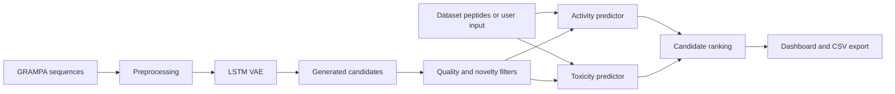

# PeptideLab

### AI-Based Antimicrobial Peptide Generation and Screening

PeptideLab is an end-to-end research application that generates peptide sequences, predicts antimicrobial activity and toxicity, and ranks candidates through an interactive Streamlit dashboard.

Built for **DSC4804 ? Statistical Learning**, the project combines an LSTM variational autoencoder, sequence classifiers, interpretable baselines, reproducible evaluation, and an interface designed for exploration and classroom demonstrations.

> Research prototype: predictions are computational estimates. They do not establish experimental antimicrobial efficacy or biological safety.

## Final document alignment

The final project includes a trained **ESM-2 + CNN** alternative, measured against the compact models on the same splits. The compact models remain the default because both achieved higher validation ROC-AUC. Choose either engine in the dashboard.

Read [Final alignment and team guide](Documentation/FINAL_ALIGNMENT_AND_TEAM_GUIDE.md) for the combined charter, literature-review and presentation mapping, architecture, actual results and demo steps. Read [Presentation update guide](Documentation/PRESENTATION_UPDATE_GUIDE.md) before presenting the older slides.

Sequence filtering and validation-selected property screening are separate. Every sequence-filter survivor remains ranked, plotted and exported, with its property-screen flag. Both product and weighted-difference ranking are available. New evidence includes sequence-similarity overlap, amino-acid composition and total VAE loss.

## Features

- **Generate and rank:** sample peptide candidates from a trained VAE, apply sequence-quality filters, predict activity and toxicity, and export a ranked shortlist.
- **Dataset explorer:** browse GRAMPA and labeled activity/toxicity benchmarks; filter by length, sequence fragment, label, and dataset split; predict selected peptides or seeded random batches.
- **Custom screening:** enter sequences, paste FASTA text, or upload FASTA/TXT/CSV files.
- **Label comparison:** compare predictions with available benchmark labels and inspect each predictor's split membership. Missing labels remain unavailable.
- **Prediction history:** revisit the latest ten runs within a browser session and download results.
- **Evaluation dashboard:** inspect held-out metrics, confusion matrices, validation curves, feature importance, and data provenance.
- **Research checks:** explore latent-vector diagnostics, predictor bias, bootstrap intervals, ranking sensitivity, and 22 controlled toy-VAE experiments.
- **Learning resources:** executed notebooks, a final report, and explanations for the demonstration and viva.

## Workflow



Activity and toxicity predictors learn from separate labeled benchmark datasets. The generator learns sequence patterns from GRAMPA.

## Quick start

### Requirements

- Python 3.11?3.13; the recorded run used Python 3.13.7.
- A CPU is sufficient; a GPU is optional and is not required by the delivered application.
- Internet access for dependency installation. Once installed, the included data and models support offline inference.

Download or clone this repository, open its root folder, and create a virtual environment.

**Windows / PowerShell**

```powershell
python -m venv .venv
.venv\Scripts\python -m pip install -r requirements-lock.txt
.venv\Scripts\python -m streamlit run app.py
```

**macOS / Linux**

```bash
python3 -m venv .venv
.venv/bin/python -m pip install -r requirements-lock.txt
.venv/bin/python -m streamlit run app.py
```

Open **http://127.0.0.1:8501**. Keep the terminal running while using the dashboard.

`requirements-lock.txt` records direct dependency versions used for the saved artifacts; it is not a complete transitive environment lock. `requirements.txt` provides compatible version ranges for development. Use the recorded scikit-learn version when loading the included random-forest artifacts.

On Windows, **RUN_PROJECT.bat** also starts the app using the `python` interpreter on your PATH. No retraining is needed for the demonstration.

## Try dataset predictions

1. Open **Dataset explorer**.
2. Choose **Toxicity benchmark** and the **test** split.
3. Select peptides from the displayed page, or choose a random batch.
4. Click **Predict dataset activity & toxicity**.
5. Inspect scores, known labels, prediction agreement, and per-model split membership.
6. Download the result CSV or revisit the run in **Prediction history**.

Use **Activity benchmark** to compare activity labels, **GRAMPA** to explore known sequences, or **Screen sequences** to supply your own inputs. Supported custom inputs contain 5?200 standard amino-acid residues, with up to 500 sequences per batch. CSV uploads require a `sequence` column.

## Models and ranking

| Component | Implementation |
|---|---|
| Generator | LSTM VAE; embedding 32, hidden size 96, latent dimension 24 |
| VAE training | Masked reconstruction cross-entropy, KL warmup to 0.02, word dropout 0.2 |
| Sequence classifiers | Learned residue embeddings; CNN kernels 3, 5, and 7; pooled features plus 25 sequence descriptors |
| Baseline | Random forest using amino-acid composition and sequence properties |
| Activity inference | Equal-weight CNN/random-forest ensemble, selected by validation ROC-AUC |
| Toxicity inference | CNN, selected by validation ROC-AUC |

The ranking rule is:

```text
priority_score = 100 ? activity_score ? (1 ? toxicity_score)
```

Higher priority favors higher activity scores and lower toxicity scores. This is a transparent preference rule, not a calibrated probability of success.

Generation filters remove truncated, out-of-range, very repetitive, duplicate, and exact known sequences. Choose the number of raw sequences to sample. Every sequence that passes the filters is scored and ranked together. The table and CSV include rank (1 is best); the graph plots every accepted sequence with rank and sequence in its hover details. Passed filters and Ranked & exported have the same count.

## Data and evaluation

| Dataset/task | Training | Validation | Test |
|---|---:|---:|---:|
| VAE: GRAMPA, lengths 5?60 | 5,208 | 651 | 651 |
| Activity benchmark | 10,671 | 2,668 | 8,877 |
| Toxicity benchmark | 2,627 | 657 | 580 |

Raw GRAMPA contains **51,345 records** and **6,760 unique canonical sequences**. Filtering to lengths 5?40 yields 6,154 sequences; lengths 5?60 yield 6,510.

Classifiers retain the published test files after cleaning. Invalid sequences, conflicting labels, and duplicates are handled before splitting. Any exact train/test overlap is removed from training. Scaling uses training data only; validation data selects checkpoints and deployed model combinations. Each task's splits have no identical sequences in common. Similar peptide families may still cross splits.

External data files are pinned to a repository commit and recorded with SHA-256 checksums in [sources.json](Data/external/sources.json). See [data cards](Documentation/DATA_CARDS.md) for label definitions and provenance limitations.

### Held-out classification results

| Task | Selected model | Accuracy | Precision | Recall | F1 | MCC | ROC-AUC |
|---|---|---:|---:|---:|---:|---:|---:|
| Activity | CNN + random forest | 0.9619 | 0.9459 | 0.9208 | 0.9332 | 0.9067 | 0.9916 |
| Toxicity | CNN | 0.9224 | 0.9375 | 0.8922 | 0.9143 | 0.8444 | 0.9718 |

These values come from the saved test predictions and metrics in [Results/final](Results/final). They measure benchmark-label prediction and should be interpreted with the dataset limitations below.

### Additional experiments

- Frozen-model latent controls: validation reconstruction cross-entropy rises from approximately **1.729** with encoder means to **3.594** with zero vectors and **4.420** with shuffled vectors, supporting latent dependence under this protocol.
- **22 controlled toy runs:** ten default seeds, nine latent-dimension comparisons, and three no-word-dropout comparisons. Matched comparisons retain identical sampled sequences and splits within each seed.
- Length-only baselines, error exports, reliability bins, and 300-replicate stratified bootstrap intervals.
- Ranking sensitivity under illustrative activity/toxicity preferences.

These are new studies with saved artifacts, not recovered historical experiment results. Small toy experiments do not establish optimal settings for full-data training.

## Project structure

```text
peptidelab/
??? app.py                       # Streamlit entry point
??? .streamlit/                  # Theme and local server configuration
??? peptide_lab/                 # Models, preprocessing, inference, dashboard, studies
??? Data/
?   ??? raw/                     # GRAMPA source CSV
?   ??? external/                # Pinned labeled benchmark files and provenance
?   ??? processed/               # Clean sequence pool required by inference
?   ??? final/                   # Reconstructed datasets and exact model splits
??? Models/final/                # Deployed model artifacts
??? Results/final/               # Metrics, predictions, plots, and experiment evidence
??? Notebooks/                   # Executed project and dataset-prediction walkthroughs
??? Documentation/               # Reports, data cards, demo guide, decisions, status
??? scripts/                     # Download, reporting, notebook execution, verification
??? tests/                       # Data integrity and application workflow tests
??? requirements.txt
??? requirements-lock.txt
??? RUN_PROJECT.bat
??? TRAIN_PROJECT.bat
??? EVALUATE_PROJECT.bat
```

Keep this structure intact: the app resolves data and model paths relative to the repository root. The completed toy-run folders support the saved research evidence and tests.

## Reproduce and verify

Run commands from the repository root with your virtual environment's Python interpreter.

```bash
# Verify the application, model integrity, data splits, and dataset workflow
python -B scripts/verify_project.py

# Reconstruct preprocessing and evaluate the existing frozen models
python -m peptide_lab.preprocessing
python -m peptide_lab.evaluation

# Reproduce/resume the controlled toy study
python -m peptide_lab.toy_study

# Build the updated report and execute its teaching notebook
python scripts/build_extended_report.py
python scripts/execute_walkthrough.py --notebook Notebooks/04_Dataset_Prediction_and_Research.ipynb
```

The clean project copy passed **13 tests**. Verification writes the actual output and exit status under `Results/final/extended/`.

Optional full retraining:

```bash
python -m peptide_lab.training
python -m peptide_lab.pipeline
python scripts/build_report.py
python scripts/execute_walkthrough.py
```

Retraining archives the previous models, results, and splits under `Results/archives/`. After retraining, rerun extended evaluation and report generation so displayed evidence corresponds to the new models. On Windows, `TRAIN_PROJECT.bat` and `EVALUATE_PROJECT.bat` provide these workflows.

To download the labeled benchmark files again:

```bash
python scripts/download_data.py
```

The downloader reuses the manifest's pinned revision. Changing it requires an explicit `--revision` argument. The supplied raw GRAMPA CSV is already included.

## Documentation

- [Complete project report](Documentation/COMPLETE_PROJECT_REPORT.html) ? self-contained HTML with embedded figures; download and open in a browser.
- [Demo and viva guide](Documentation/DEMO_AND_VIVA.md)
- [Project walkthrough notebook](Notebooks/03_Final_Project_Walkthrough.ipynb)
- [Dataset prediction and research notebook](Notebooks/04_Dataset_Prediction_and_Research.ipynb)
- [Data cards](Documentation/DATA_CARDS.md)
- [Implementation status](Documentation/IMPLEMENTATION_STATUS.md)
- [Project decisions](Documentation/PROJECT_DECISIONS.md)

`Documentation/FINAL_REPORT.html` is retained as the base input for the extended-report builder. Executed notebooks can contain printed paths from their original run; rerunning them resolves the current project location.

## Limitations

- Activity prediction estimates binary antimicrobial-class membership; it does not predict MIC or species-specific susceptibility.
- Toxicity predictions refer to the supplied dataset's label. The spreadsheets do not establish a comprehensive dose-, tissue-, or assay-specific safety endpoint.
- Scores are uncalibrated model outputs. A high priority score does not establish efficacy or safety.
- Activity labels have a substantial length imbalance: a length-only baseline reaches approximately 0.967 ROC-AUC. The short activity test subset has only eight negatives, making its raw accuracy misleading.
- Exact sequence separation does not prevent similarity-based leakage. No independent similarity-disjoint external evaluation is claimed.
- Generated uniqueness and exact novelty do not demonstrate biological function. Free-running exact reconstruction remains weak.
- The classifiers use learned residue embeddings, not ESM-2. Exact reproduction of reference architectures or their reported performance is not claimed.
- No laboratory experiments have validated generated candidates.

## Troubleshooting

- **Port occupied:** run `python -m streamlit run app.py --server.port 8502`.
- **Missing models/data:** retain `Models/final`, `Data`, and `Results/final` when copying or cloning the project.
- **Random-forest loading error:** install the recorded dependency versions or retrain with your installed environment.
- **Old interface after editing:** restart the Streamlit server; automatic file watching is disabled.
- **Fewer generated candidates:** widen the accepted length range or change the sampling seed; the interface reports the actual number returned.

## Team

| Member | Focus |
|---|---|
| Chirag | Generative model, preprocessing, and integration |
| Hurshvardhan Rao | Activity/toxicity prediction and evaluation |
| Aniket Mishra | Candidate filtering, ranking, and visualization |

AI assisted implementation, debugging, testing, and documentation. The team is responsible for understanding and verifying the work and disclosing assistance according to course requirements.

## References and data attribution

- [GRAMPA dataset and source repository](https://github.com/zswitten/Antimicrobial-Peptides)
- [UniDL4BioPep benchmark repository](https://github.com/dzjxzyd/UniDL4BioPep)
- Du et al. (2023), [UniDL4BioPep: a universal deep learning architecture for binary classification in peptide bioactivity](https://doi.org/10.1093/bib/bbad135).
- Dean et al. (2021), [PepVAE: Variational Autoencoder Framework for Antimicrobial Peptide Generation and Activity Prediction](https://doi.org/10.3389/fmicb.2021.725727).

Third-party datasets and referenced materials remain subject to their owners' terms. Consult the source repositories before redistributing their data. No project-wide license has been selected in this repository.
